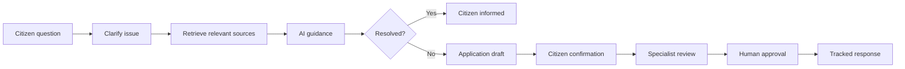
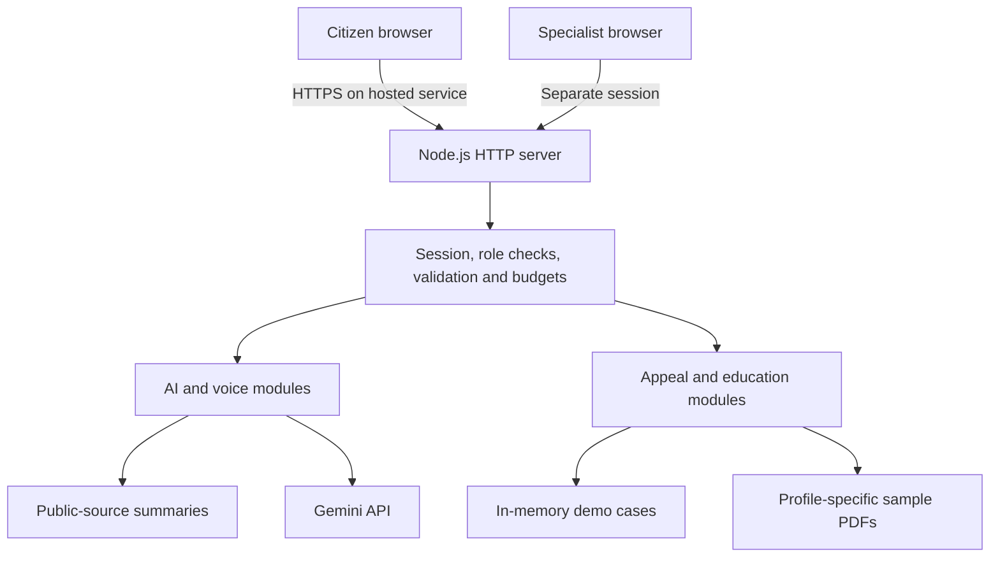

<div align="center">
  
  <h1>Murojaat EDU</h1>
  <b>TA’LIM INTELLEKTI · EDUCATION INTELLIGENCE</b>
  <p>From a citizen's question to a clear, traceable resolution.</p>
  <p><i>Har bir murojaat — yechim sari.</i></p>


**Umummilliy AI Xakaton · Tashkent, Uzbekistan · 17–19 November 2026**

[Why Murojaat EDU?](#why-murojaat-edu) · [Product](#product-capabilities) · [Architecture](#technical-architecture) · [Security](#security-and-responsible-ai) · [Quick start](#quick-start) · [Roadmap](#roadmap) · [Team](#team)
</div>

> **Project status:** Independent hackathon prototype, not an official government service. All citizen records, downloaded documents, feedback and submitted cases are demonstration data. Never submit real personal information, credentials or sensitive recordings.

## Executive overview

**Murojaat EDU is an AI-powered GovTech and EdTech platform designed to make education-related public services easier to understand, access and resolve in Uzbekistan.** It connects citizens seeking answers with specialists responsible for resolving their appeals, within one traceable digital workflow.

Instead of requiring citizens to search multiple portals, interpret complex regulations or repeatedly call a hotline, Murojaat EDU aims to clarify their problem, retrieve relevant official-source summaries, provide understandable guidance and prepare a structured application when human review is needed.

For education authorities, it offers a specialist workspace, AI-assisted response drafting, appeal classification, status tracking and visibility into recurring issues. The long-term vision is to become an intelligent service layer across the education ecosystem, complementing existing state platforms rather than replacing them.

## Why Murojaat EDU?

Imagine calling an education hotline and hearing **“Navbatingiz: 36.”** The queue is an illustrative scenario, not a measured waiting-time statistic. Citizens need timely, understandable answers; specialists need tools that reduce repetitive manual work.

| Indicator | Scale |
| --- | ---: |
| Official appeals, January–June 2026 | 4,572 |
| Hotline calls in the same period | 28,000+ |
| Appeals submitted electronically | 85.4% |
| Higher-education students, 2025/26 | 1.535 million |
| Higher-education teaching staff | 54,900 |
| Higher-education institutions | 215 |

Approximately **1.59 million** students and teaching staff form the initial potential audience. These are population and reported activity figures, not current platform users; call and appeal counts may overlap and must not be added together. Figures follow the team's pitch source references listed below.

## Product capabilities

| Capability | Description | Status |
| --- | --- | --- |
| Multilingual AI assistant | Education guidance with source links, clarification and recent conversation context | MVP |
| Voice messages | Record audio and receive an editable transcript | MVP, provider-dependent |
| Voice conversation | Turn-based speech recognition, AI reply and speech playback | MVP, provider-dependent |
| Digital academic cabinet | Five demo profiles and 19 downloadable sample PDFs | MVP, synthetic |
| Scholarships and grants | Opportunity directory, source links and personalized suggestions | MVP |
| Automated application drafts | Prepare a structured appeal from a demo profile; citizen confirms submission | MVP |
| Appeal lifecycle | Case identifier, progress tracking and approved specialist replies | MVP, in memory |
| Specialist workspace | Separate login, queue, AI draft assistance and status management | MVP |
| Complaint radar | Group recurring issues and simulate multi-channel incident patterns | MVP, synthetic |
| Interactive dashboard | Auto-refreshing aggregate metrics, animated SVG branding and responsive UI | MVP |
| Official identity and records | OneID, HEMIS, Mehnat and other authorized government services | Planned; simulated today |
| Local AI | Retrieval-augmented generation (RAG), locally hosted open-weight model and fine-tuning | Planned |

### Citizen experience

- Ask questions about scholarships, tuition, diplomas, dormitories, transfers, academic systems and related services.
- Select Uzbek, Russian, Tajik, Karakalpak or English. Major navigation is translated; detailed demo content and offline answers are primarily Uzbek.
- Use voice input or turn-based voice conversation (not full-duplex live audio).
- Explore synthetic student, pupil, graduate, teacher and former-teacher profiles; view relevant GPA, grades, study or employment history and download profile-specific PDFs.
- Discover scholarship and grant opportunities, including presidential and named scholarships, with links for official verification. Recommendations do not guarantee eligibility or awards.
- Confirm an application draft and follow the case through review and resolution.

### Specialist experience

The specialist portal combines appeal management, AI-assisted draft responses, aggregate metrics and recurring complaint detection. A specialist must explicitly approve a resolution before it is published to the citizen in the demo workflow. The AI does not issue binding decisions.



The workflow is a product vision implemented at prototype level; it does not represent an official appeal submission to the ministry.

## Technical architecture

A lightweight modular client-server application with a zero-external-npm-dependency runtime. All privileged operations and Gemini credentials remain on the backend. The browser communicates with the Node.js service using same-origin JSON APIs.



| Layer | Technology |
| --- | --- |
| Frontend | HTML5, CSS3, vanilla JavaScript, animated SVG |
| Backend | Node.js 22+, native HTTP server, ES modules |
| AI | Configurable Gemini generateContent API; keyword-based source retrieval |
| Voice | Browser MediaRecorder, Gemini audio transcription and TTS, WAV playback |
| Demo storage | JSON, pre-generated PDFs and bounded in-memory state |
| Deployment | Render, GitHub, native Node runtime |
| Testing | Node.js built-in test runner and GitHub Actions |
| Planned production | PostgreSQL, private object storage, authorized APIs, RAG and local LLM |

### Repository structure

```text
murojaat-edu/
├── public/
│   ├── index.html       # Citizen and specialist interface shell
│   ├── app.js           # Browser logic, voice, UI and API calls
│   ├── style.css        # Responsive design, themes and effects
│   ├── logo.svg         # Animated sealed-envelope identity
│   └── news-*.svg        # Local education illustrations
├── src/
│   ├── ai.js            # Gemini integration, retrieval and fallback
│   ├── voice.js         # Audio transcription and speech generation
│   ├── core.js          # Classification, cases, rules and statistics
│   └── education.js     # Demo profiles, opportunities and recommendations
├── data/
│   ├── knowledge.json   # Public-source summaries and links
│   └── pdfs/            # 19 watermarked sample documents
├── test/core.test.js    # Automated backend tests
├── .github/workflows/   # Continuous integration
├── server.js            # HTTP routing, sessions and authorization
├── .env.example         # Safe environment template
├── render.yaml          # Hosting configuration
├── DEPLOY.md            # Deployment instructions
└── README.md
```

## Security and responsible AI

Murojaat EDU adopts a defense-in-depth approach. The prototype is not security-certified and has not undergone a full independent penetration test.

**Implemented controls:**

- Server-side API secrets; `.env` excluded from version control.
- Separate citizen and specialist sessions, 192-bit random tokens, HttpOnly and SameSite=Strict cookies; Secure cookie flag when `NODE_ENV=production`.
- CSRF tokens for POST requests, backend role checks and profile-scoped PDF access.
- Content Security Policy, anti-clickjacking and MIME-sniffing protection.
- Basic text validation and pattern checks for common personal identifiers (not comprehensive anonymization).
- Bounded request bodies (3 MB), basic per-session login limits and AI request budgets (20 per 10 minutes per session; default 50 per day globally).
- Session/profile-based case filtering and explicit human approval for resolved cases.
- AI prompts restrict model behavior, validate response shape and returned source IDs, and fall back to rule-based answers when the provider fails or citations are invalid. This is not a guarantee of factual accuracy or prompt-injection resistance.

**Production hardening priorities:** WAF and upstream DDoS protection, IP/account-based throttling, MFA and authorized OneID integration, credential rotation, persistent role-based authorization, private database networking, parameterized queries, encryption at rest, audit trails, vulnerability scanning, independent penetration tests, disaster recovery and approved personal-data handling. Use only authorized data and confirm applicable Uzbek localization and cross-border processing requirements before connecting real citizen services.

## Quick start

Requirements: Node.js 22+ and npm. Git is optional if downloading the repository ZIP.

```bash
npm ci
cp .env.example .env
npm start
```

For Windows PowerShell:

```powershell
npm.cmd ci
Copy-Item .env.example .env
npm.cmd start
```

Edit `.env` privately before starting (never overwrite an existing working configuration without a backup).

```dotenv
GEMINI_API_KEY=YOUR_PRIVATE_KEY
GEMINI_MODEL=gemini-3.8-flash
GEMINI_TTS_MODEL=gemini-3.8-flash-tts
ADMIN_ACCESS_CODE=YOUR_STRONG_PRIVATE_PASSWORD
DEMO_ACCESS_CODE=YOUR_SHARED_DEMO_PASSWORD
AI_DAILY_LIMIT=50
PORT=3000
```

Model names are configurable; use models available to your account. A valid key and model listing do not guarantee generation quota or availability. Obtain a key from [Google AI Studio](https://aistudio.google.com/api-keys). Without a working AI connection, supported text questions can use the local fallback; voice requires an available provider (browser speech synthesis can be attempted for playback).

| Interface | Local URL |
| --- | --- |
| Citizen portal | http://localhost:3000 |
| Specialist portal | http://localhost:3000/admin |
| Health check | http://localhost:3000/healthz |

Run `npm test` and `npm run check` to verify the backend and syntax (use `npm.cmd` on Windows if PowerShell blocks npm scripts). Microphone access requires localhost or HTTPS and browser permission.

### Hosting

Deploy the repository as a **Node.js Web Service** on Render, not a static site. Build: `npm ci`; start: `npm start`; health check: `/healthz`. Set `NODE_ENV=production`, a strong administrator password, a shared demo access code and AI environment variables in the hosting dashboard. Do not upload `.env` or `node_modules`. See [DEPLOY.md](DEPLOY.md).

## Business model and potential

The proposed model is **B2G (business-to-government)**: education authorities fund deployment and support while essential citizen access remains free. Pricing would be validated by pilot outcomes and procurement requirements.

| Proposed commercial stage | Illustrative price |
| --- | ---: |
| Controlled 3-month pilot | $3,000 |
| Staged deployment | $4,500/month |
| National higher-education service | $7,000/month |

These are proposed contract prices from the team's pitch, not signed contracts, actual revenue or guaranteed ROI. The pilot should measure answer quality, processing time, accessibility and cost per resolved case.

### Strategic positioning

| Reference | Role in the ecosystem |
| --- | --- |
| my.gov.uz | Digital government services and citizen service guidance |
| HEMIS AI | Academic information, analysis and recommendations |
| HCLTech | International enterprise AI and customer-experience technology benchmark |
| Murojaat EDU | Proposed education-specific guidance-to-appeal workflow with specialist approval |

These are ecosystem references, not claimed partnerships or exhaustive comparisons. Potential expansion includes authorized OneID login, academic and employment record retrieval, Telegram/email intake, university helpdesks, ministry analytics, accessible voice services and other public-service domains.

## Roadmap

| Phase | Deliverables |
| --- | --- |
| Now — hackathon MVP | Demonstrate text/voice, synthetic documents, appeal lifecycle and specialist review |
| Months 1–3 | Rent Uzbekistan-hosted infrastructure; controlled pilot on three priority topics; approved data, expert-reviewed test set and baseline measurements |
| Months 4–6 | Dedicated GPU-enabled server, persistent storage, verified source ingestion, RAG and adaptation of a suitable open-weight LLM; keep external API fallback subject to data policy |
| Months 6–12 | Authorized integrations, production security review and phased rollout if pilot results support it |
| Long term | Scale to additional education segments and institutions; continue model evaluation and service improvement |

### Indicative technical investment

| Item | UZS |
| --- | ---: |
| Three months of Uzbek server rental, AI and security | 18,000,000 |
| Dedicated server, UPS and networking | 45,000,000 |
| GPU infrastructure | 65,000,000 |
| Data preparation, RAG, fine-tuning and evaluation | 25,000,000 |
| Migration and security reserve | 12,000,000 |
| **Total phased technical budget** | **165,000,000** |

Planning estimates, not supplier quotations; excludes salaries, taxes and ongoing post-migration expenses. The model budget assumes inference and parameter-efficient fine-tuning of an existing open-weight model, not training a foundation model from scratch.

### Pilot success criteria

- **≥90%** accurate, source-supported answers on an expert-reviewed evaluation set.
- **≥25%** reduction in active specialist processing time on comparable cases.
- **100%** human approval of official responses in the controlled workflow.

These are target KPIs, not achieved results. Evaluate against baselines with ministry experts before scaling.

## Current limitations

- Real OneID, HEMIS, Mehnat and government service integrations require authorization and have not been implemented.
- Cases and sessions reset on service restart; no production database or durable audit trail yet.
- The knowledge base consists of curated summaries and links, not a complete or continuously synchronized legal corpus.
- Gemini may return quota, authentication or availability errors; text fallback is limited, voice availability varies. Automatic retry/model failover and local LLM hosting are roadmap items.
- Demo login is not verified identity; PDFs have no legal validity. No official applications or decisions are issued.
- Automated tests cover prototype backend behavior; live AI, browser compatibility, capacity and independent security testing require further validation.

## Team

| Team member | Role |
| --- | --- |
| Abdullayev Olimjon | CEO / CTO |
| Muhiddinov Fahriddin | Business Analyst |
| Ganiyeva Shoxsanam | CMO |
| Murodov Alisher | UI/UX Designer |

## Sources and references

- [Ministry appeal analysis, Jan–Jun 2026](https://gov.uz/oz/edu/sections/view/194169)
- [National Statistics Committee — Higher education, 2025/26](https://stat.uz/img/news/olij-talim-lotin_p44563.pdf)
- [MyGov AI usage](https://my.gov.uz/uz/static/ai-usage) · [HEMIS AI](https://gov.uz/oz/edu/news/view/118718) · [HCLTech](https://www.hcltech.com/)
- [Gemini API audio documentation](https://ai.google.dev/gemini-api/docs/audio) · [Speech generation](https://ai.google.dev/gemini-api/docs/speech-generation)
- [Appeals legislation](https://lex.uz/docs/-3336169) · [Personal data legislation](https://lex.uz/docs/-4396419)

## Collaboration and licensing

We welcome collaboration with education experts, universities, infrastructure providers and authorized public-sector stakeholders on a controlled pilot. Do not submit real personal information or credentials in GitHub issues. No open-source license is asserted here; refer to the repository owner's licensing decisions before redistribution.

<div align="center">
  <b>Murojaat EDU — Har bir murojaat, yechim sari.</b><br />
  Built for the future of accessible education services in Uzbekistan.<br />
  #MilliyAIXakaton #ToshkentAI
</div>
